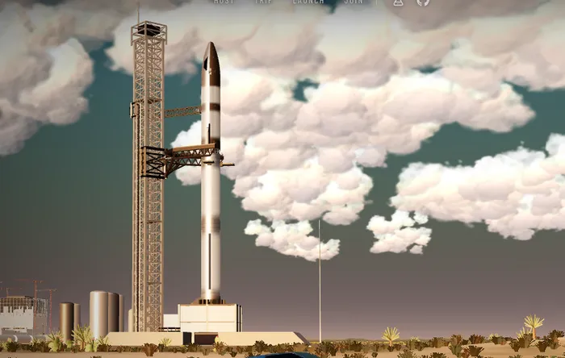
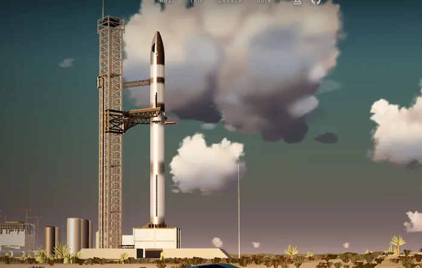
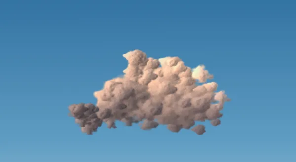
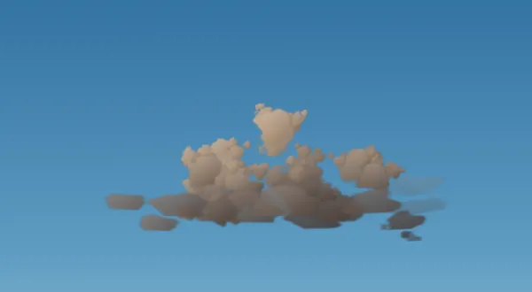
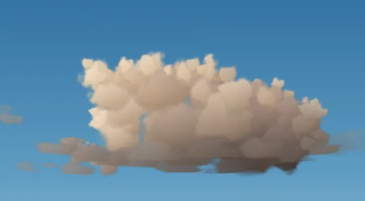
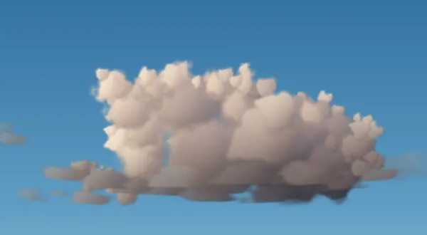
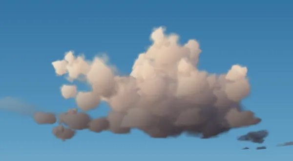
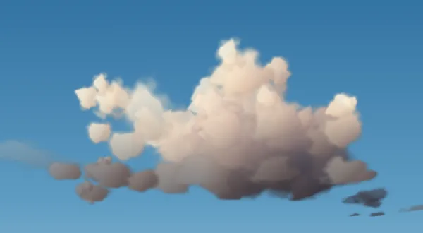
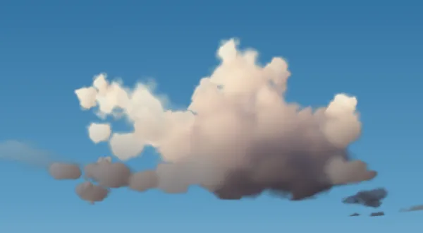
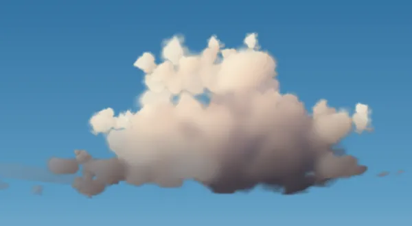

# How the clouds got good

The hero's clouds are a few thousand flat sprites ("puffs") drawn in one instanced batch. There is no raymarching
and no volume texture. This is how they went from popcorn to cumulus in one long evening of feedback rounds,
and what each step taught us.

## 1. Make a benchmark

Tuning clouds inside the hero was slow and subjective: they sit behind a rocket, in moving shots, at one sun
angle. So we built [`/lab/clouds/`](https://chernetsov.github.io/77-to-starbase/lab/clouds/). It renders single
cumulus with the hero's own code on a clear sky, with the seed, size, sun and camera height in the URL. A small
script snapped four seeds and set them beside a golden-hour cumulus photo (kept locally; it isn't ours to
publish). Every change after this was judged on that sheet, about twenty rounds in all.

The benchmark paid off at once. An earlier fix flattened each puff's shading to hide the paper look; it only
worked because the hero's sun sits behind the camera. With a side sun in the lab, the clouds went dark.

## 2. Build it like a real cumulus

A cumulus has a structure, so the generator (`addCumulus` in `scenery.ts`) follows it:

- a wide, flat, darker base sheet that reaches out past everything above it, all clouds sharing one base
  altitude (`CUMULUS_BASE` = 800 m), so they line up in rows toward the horizon;
- two to four towers of different heights over a low shoulder;
- big lobes filling the towers, and on the lobes' upper, outer skin, smaller lobes, and sometimes smaller again:
  the cauliflower;
- a few tiny cloudlets and thin wisps near the base: thermals that didn't make it.

## 3. Light it like a volume

Flat lighting was the root of the "papery" look. The light model now borrows from film and game cloud rendering:

- **Shadow through the cloud.** Each pixel is dimmed by how much cloud lies between it and the sun (Beer's law).
  That depth comes from two places: a chord through the cloud's bounding ellipsoid, and a per-puff value baked
  when the cloud is built, by summing the chords of the sun ray through every other puff (Harris & Lastra,
  *Real-Time Cloud Rendering*, 2001).
- **Light bouncing inside.** Four octaves of multiple scattering, each weaker, less absorbed and less directional
  than the last (Wrenninge et al., *Oz: The Great and Volumetric*, 2013). Shadows glow instead of going grey.
- **Direction of scattering.** A two-lobe Henyey–Greenstein phase: forward for silver linings, a little
  backward because the hero sun is behind the camera. Without the backward lobe the hero clouds went stormy.
- **Powder.** Slightly darker skin on the sun side (Schneider & Vos, *The Real-Time Volumetric Cloudscapes of
  Horizon Zero Dawn*, 2015).
- **Sky above, ground below.** Blue fill on the tops, warm bounce on the undersides, both dimmer toward the base.
- **Film roll-off.** Highlights ease into cream instead of clipping greenish.

## 4. Smooth the inside, keep the edges

Next came "too many sharp knots, especially inside; borders are fine." Every puff showed its own outline and its
own little shading. That's right on the silhouette, wrong in the middle. Two steps fixed it.

First, in the shader: each puff works out how far inside its cloud's outline it sits as seen from the camera
(0 at the outline, 1 in the middle). Inner puffs get softer edges, lose their surface bumps, and take their
shading from the whole cloud's rounded shape instead of their own lump.

Then, a post-process (`CloudBlur` in `cloudblur.ts`). The clouds render to their own target, a nine-tap Gaussian
blurs it at half resolution, and the composite uses the blurred colour only where both the blurred and sharp
images are fully opaque. The outline, where the cloud fades into sky, stays sharp. In the hero the clouds draw in
their own pass between the sky and everything else, so the rocket always draws in front of them. The radius is
`cloudBlur.radius = 10` px in `scene.ts`; the lab takes `?blur=<px>` (and `?blur=0`). Phones skip it.

## 5. No holes

The last request was the holes: gaps between random lobes where the sky showed through the body. A regular
grid of buried fill puffs now follows each cloud's tower profile underneath the lobes, at two heights per column.
None of the twelve seeds checked afterwards has a hole.

## 6. The whole sky

With single clouds right, the layout of the sky mattered more. Two fixes:

- **The beach view is composed by hand.** The clouds in it sit at chosen bearings and distances, bigger ones
  off to the sides. No random cloud may stand in a cone around the ship and tower, so the stack is framed by
  open sky.
- **The horizon fills in like a real one.** A cloud field has about the same number of clouds per square
  kilometre everywhere, so the number in each distance ring grows with distance. Seen from the beach, they crowd
  into a hazy band at the horizon. The 200 far clouds (out to 90 km) are now spread that way. The Earth's
  curvature lowers the farthest ones onto the horizon, by about 600 m at 90 km. A cloud that far is a few pixels
  wide, so it gets a cheap build of about 50 puffs.

## What didn't work

- **Smooth, round puff shapes.** They read as cotton balls. Detail inside the outline is what makes cauliflower.
- **Strong self-shadowing on its own.** Every puff deep in the cloud became a dark ball with a hard edge.
- **Flattened per-puff shading.** It hid the paper look under one sun angle and broke under every other.
- **Very transparent inner puffs.** The blue sky showed through as a pale fog patch near the tops.

## Ideas not tried yet

- Merging the puffs into one surface before lighting it, as in screen-space fluid rendering (van der Laan et al.,
  *Screen Space Fluid Rendering with Curvature Flow*, 2009): splat depth and thickness, blur, light once.
- Warmer mid-tones; the photo's lit faces are more orange than ours.
- Letting the rocket pass behind the clouds near the ascent path (needs depth in the cloud pass).
