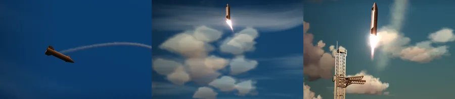
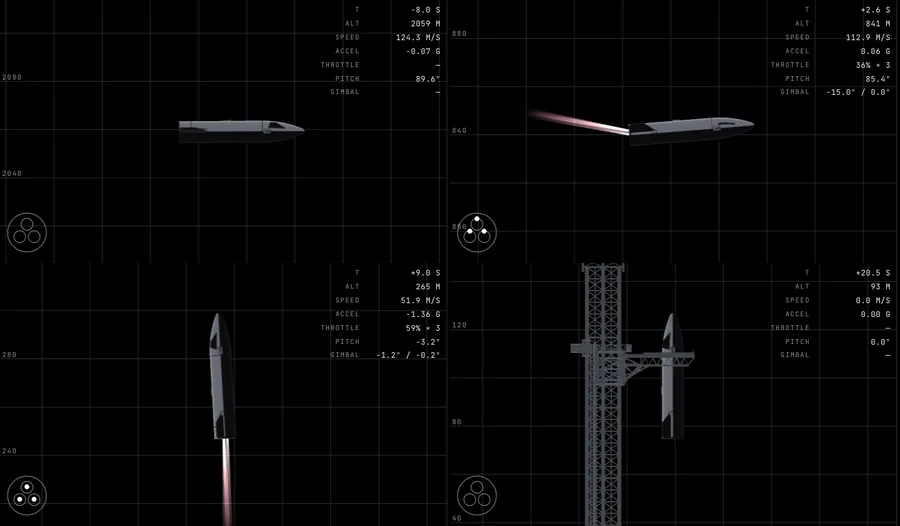
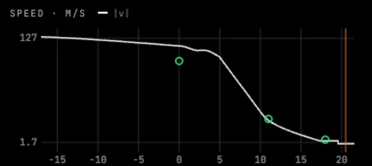
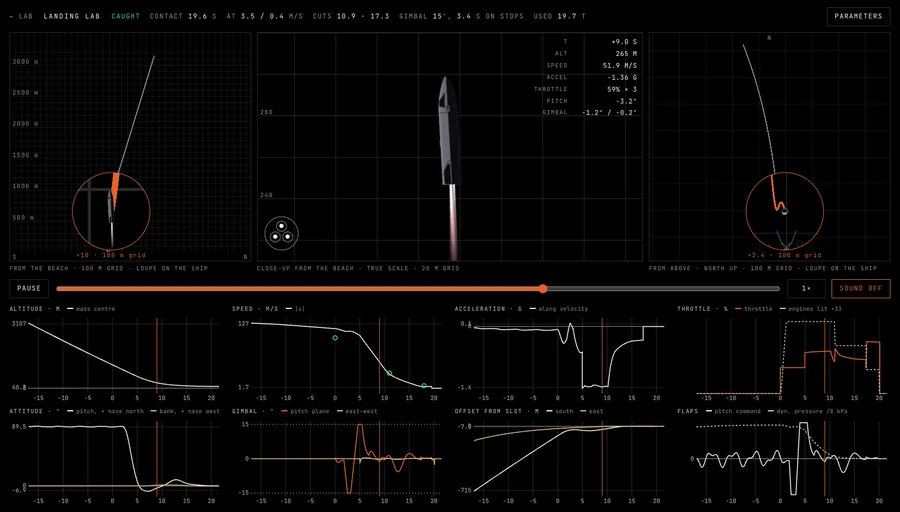

# How the ship learned to land

Flight 15 plans to fly Starship back to the pad and catch it with the tower's chopsticks, so the hero now does
the same. The last 37 seconds, from the belly flop to the catch, aren't animated by hand. They come from a small
physics simulation that steers itself, tuned until it matched SpaceX's webcasts. This is how it got there,
explained without the maths.

## 1. What a real landing looks like

From the Flight 12–14 webcasts:

- The ship falls the last kilometres **belly-first**, flaps out like a skydiver, at about 100 m/s.
- At about 1.1 km it **relights three engines**, one after another, and **flips** upright in about two
  seconds. Its speed hardly drops during the flip: the thrust is still pointing sideways.
- It then brakes at about 1.1 g. One engine shuts down at about +11 s, a second at about +18 s, and the last
  one holds the ship almost hovering into the arms.
- Through all of it the **engines swing hard and the flaps keep moving**, right up to the end. Nothing is ever
  still.

## 2. First try: a script, then a 1D simulation

The first version was choreography: keyframed height, tilt and drift. It looked wrong in a way that was easy
to see but hard to fix: the ship fell too slowly, and its own vapor trail kept pace with it instead of streaming
off above.

So the fall became physics: gravity, air drag and thrust, straight up and down, calibrated to the speed and
altitude readouts. That fixed the speed, but the sideways motion was still faked, and the flip could not push
the ship around the way a real one does.

## 3. Make it a real rigid body

The ship is now a single stiff body that moves in all three directions and turns in two (nose north–south and
east–west). About a dozen numbers describe it, updated 240 times a second. Four things act on it:

- **Gravity,** and the ship getting lighter as it burns propellant (about 20 t in 20 s).
- **Air drag,** strong side-on (belly-first) and weak end-on (tail-first). The side-on drag is set so the ship
  falls belly-first at the 100 m/s the webcasts show, and the air thins with height.
- **Three Raptors** that relight 0.35 s apart, throttle between 36% and 100%, and swing (gimbal) ±15°. They sit
  about 18 m below the ship's centre of mass, so swinging them turns the whole ship.
- **The flaps,** which twist the ship only while air is rushing past it, harder the faster it goes.

Left out: lift, wind, sloshing propellant and the small steering thrusters, whose push is a few percent of the
others' this low down.

## 4. Teach it to steer

A real ship isn't flown on a script, so ours isn't either. The controller is three questions, asked 240 times
a second, each simpler than the last. This is the textbook split for powered landing:

1. **Guidance: which way do I want to accelerate?** Vertically it follows a planned sink rate for each height:
   hard braking high up, a gentle glide below 120 m, and a steady 3.5 m/s for the last 8 m onto the rails.
   Sideways, the distance from the slot between the arms asks for a capped sideways speed, and the speed error
   asks for a capped sideways push.
2. **Attitude: lean the ship to get it.** The hull tips (at most 20°) so the thrust points the way guidance
   wants. The turning comes from swinging the engines and, while there's airflow, from the flaps, shared in
   proportion to what each can do.
3. **Throttle: how hard?** Enough for the vertical part. When the throttle sinks near its floor and the other
   engines could carry the load, one engine shuts down.

Nobody wrote "shut down at +11 s and +18 s". Those times fall out of the third rule, and they land where the
webcasts have them.

**The flip** is the same attitude loop asked to swing 90° at once. It's far more than the engines and flaps can
deliver, so both go to their limits: full push one way, then full push back to stop. That's the fastest way to
turn with limited force, and it's why the real flip looks so violent. It runs at the lowest throttle, because
while the ship is still sideways, more thrust would only shove it off course.

## 5. Tune it against the webcasts

- **The physics** comes from public figures and webcast readouts. The readouts pin down how strong the engines
  are compared to the ship's weight, not either one, so 220 t and 2.75 MN per engine is one consistent pair.
- **The braking** was chosen so the speed over time matches Flight 13 to within about 4–5 m/s.
- **The steering gains** came from sweeps over many runs, under one classic rule: each outer question must be
  answered several times more slowly than the one inside it.

## 6. The lab

Tuning inside the hero meant waiting through the whole intro for twenty seconds of landing. So it got its own
page, [`/lab/landing/`](https://chernetsov.github.io/77-to-starbase/lab/landing/):

- Three views: from the beach, a true-scale close-up, and from above. The wide views have a loupe on the ship.
- Plots of everything: altitude, speed, braking, throttle, tilt, gimbal angles, distance from the slot, flaps.
- A Parameters drawer. Change the ship's mass, the engines or the braking and it flies the run again, so you
  can see whether it still lands (or misses, or hits the ground).
- Sound as heard riding along: the relight pops, the engines, and wind that grows with speed.

## What went wrong on the way

- **A famous landing law that crept in late.** Apollo's lunar-descent guidance ("E-guidance") aims for a fixed
  arrival time. Here it crept in late and stalled above the rails. The planned sink rate took its place.
- **Swinging the engines first pushes the ship the wrong way.** To tip the nose north, the engines kick the tail
  south, so the whole ship briefly moves south. Engineers call this non-minimum phase. With quick sideways
  loops that kick fed back and set the ship rocking, so the outer loops were slowed.
- **Flaps and gimbal fighting.** Each banged between its stops doing the other's job, until the turning was
  shared in proportion to what each can deliver.
- **Engines that snapped.** The plumes jumped from side to side. Real gimbal actuators have a top speed, so the
  simulation now caps them at 20° per second (SpaceX hasn't published Raptor's; this is an estimate). The flip
  then overshot, so it got more damping; it now swings about 8° past upright and settles.
- **Flaps that kept moving after the catch.** Attitude is now held once the pins are on the rails.

## How it fits the hero

The intro plays the simulation back. Before it starts, the fast-forward carries the ship in from about 15 km
west and 9 km up along a smooth path that hands over to it at the same speed. The last metre of error is
taken out in the last three seconds so the pins land on the rails exactly, the carriage sinks on its shock
absorbers, and the last engine burns on for a third of a second after contact.

The smoke follows the physics too. The ship coasts with its engines off, so it leaves only a faint wake. Three
engines leave a thin haze shed beyond the tips of their flames, so the flames stay visible. The tanks vent
only after the catch, as thin jets that fade within metres.

## Ideas not tried yet

- An on-board trajectory optimizer like SpaceX's published method (G-FOLD, Açıkmeşe and Blackmore), which solves
  for the fuel-cheapest path many times a second, in place of the feedback loops.
- Drawing the flaps from the simulation's own command; today their visible fold follows the scene's
  choreography, and only their twisting force is physics.
- Wind, and an engine that fails to relight.
